# Informe técnico — Clasificación de escenarios naturales con una Red Neuronal Convolucional (CNN)

**Evaluación Parcial N°2 — TLY1102 Técnicas Avanzadas de Machine Learning I**
**Sección:** 0001D
**Integrantes:** Javier Garcia
**Dataset:** Intel Image Classification (Kaggle)
**Modelo principal:** Red Neuronal Convolucional (CNN) — Keras / TensorFlow
**Modelo de comparación:** Perceptrón Multicapa (MLP) de la Evaluación Parcial N°1

---

## 1. Resumen ejecutivo

El presente trabajo es la **continuación directa** del proyecto de la Evaluación Parcial N°1, donde
se abordó la clasificación automática de escenarios naturales con un **Perceptrón Multicapa (MLP)**.
El MLP, al **aplanar** cada imagen, pierde la estructura espacial y alcanzó un 47,7 % de exactitud,
confundiendo sistemáticamente clases con paletas de color similares (`sea`, `glacier`, `mountain`).

En esta entrega se propone una **Red Neuronal Convolucional (CNN)**, diseñada para explotar la
estructura espacial mediante filtros convolucionales. El modelo se entrena sobre el **mismo dataset**
y se compara con el MLP bajo **condiciones idénticas** (misma partición, resolución y aumento de
datos), de modo que la única diferencia sea la arquitectura. Adicionalmente, se visualizan
**mapas de características (feature maps)** para interpretar qué aprende la red y se realiza un
**análisis de errores** por clase.

## 2. Contexto y problema de negocio

Plataformas de viajes, medios de comunicación y bancos de imágenes reciben a diario miles de
fotografías **sin etiqueta ni metadato** que describa su contenido. Clasificar manualmente ese
volumen por tipo de escenario (edificios, bosque, glaciar, montaña, mar o calle) es lento, costoso y
no escala.

Este proyecto aborda ese problema a menor escala: construir un modelo capaz de **clasificar
automáticamente una fotografía de paisaje o zona urbana en una de 6 categorías**, como primer paso
hacia un sistema de **etiquetado automático de imágenes**.

## 3. Objetivos

**Objetivo general.**
Diseñar, entrenar y evaluar una Red Neuronal Convolucional (CNN) que clasifique imágenes de paisajes
y escenas urbanas en 6 categorías, y contrastar su desempeño con el MLP de la Evaluación Parcial N°1.

**Objetivos específicos.**

1. Preparar el conjunto de datos de imágenes para una CNN (redimensionado, normalización, formato
   matricial y partición de datos).
2. Diseñar e implementar una arquitectura CNN justificando cada decisión técnica.
3. Entrenar el modelo y analizar las curvas de aprendizaje.
4. Evaluar el desempeño con métricas de clasificación (accuracy, precision, recall, F1, matriz de
   confusión y ROC/AUC).
5. Comparar cuantitativamente el MLP y la CNN (desempeño, parámetros, tiempo y generalización).
6. Visualizar mapas de características para interpretar el comportamiento de la CNN.
7. Analizar los errores del modelo e identificar las clases más difíciles.

## 4. Indicadores clave de desempeño (KPI)

| KPI | Definición | Meta |
|---|---|---|
| **Accuracy** | Proporción de imágenes correctamente clasificadas en test | Superar el 47,7 % del MLP de la EP1 |
| **F1-Score (weighted)** | Media armónica de precisión y recall, ponderada por soporte | Lo más cercano posible a la accuracy (clases balanceadas) |
| **Recall por clase** | Capacidad de detectar cada categoría | Detectar las 6 clases de forma pareja |
| **Brecha train–validación** | Diferencia de accuracy entre entrenamiento y validación | Baja (buena generalización) |
| **Eficiencia** | Relación desempeño / n.º de parámetros | Buena: menos parámetros que el MLP con mejor accuracy |

## 5. Fuentes de datos

**Dataset:** *Intel Image Classification* (Intel / Kaggle).

- **Origen:** <https://www.kaggle.com/datasets/puneet6060/intel-image-classification>
- **Contenido:** fotografías de paisajes y escenas urbanas de 6 clases mutuamente excluyentes:
  `buildings`, `forest`, `glacier`, `mountain`, `sea`, `street`.
- **Tamaño:**

| Split | Uso | Imágenes |
|---|---|---|
| `seg_train` | entrenamiento + validación | ~14.034 |
| `seg_test` | evaluación final independiente | 3.000 |
| `seg_pred` | imágenes sin etiqueta (demostración) | ~7.300 |

Los datos se descargan automáticamente desde Google Drive al ejecutar el cuaderno, por lo que **no
se versionan** en el repositorio.

## 6. Análisis exploratorio de datos (EDA)

### 6.1 Balance de clases

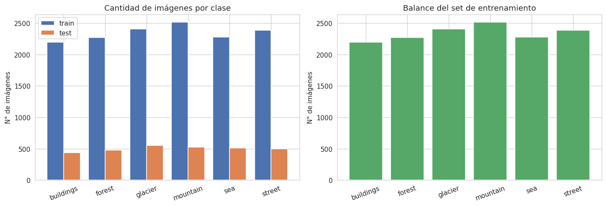

Las 6 clases tienen cantidades similares tanto en entrenamiento (~2.190–2.510) como en test
(~437–553). **No hay desbalance relevante**, por lo que la *accuracy* es una métrica de referencia
válida y no se requieren técnicas de balanceo de clases.

### 6.2 Ejemplos por clase

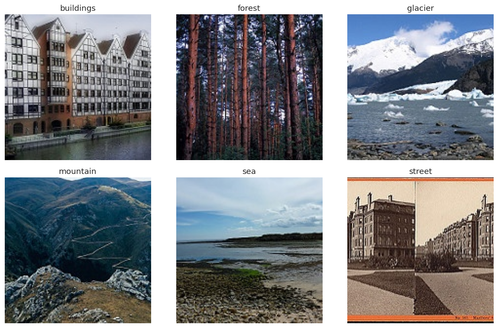

Se observa que `glacier` y `mountain` comparten tonos blancos/grises (nieve y roca), y que algunos
encuadres de `sea` y `street` pueden parecerse. Esto **anticipa dónde se concentrarán los errores**
del modelo.

### 6.3 Tamaño de las imágenes

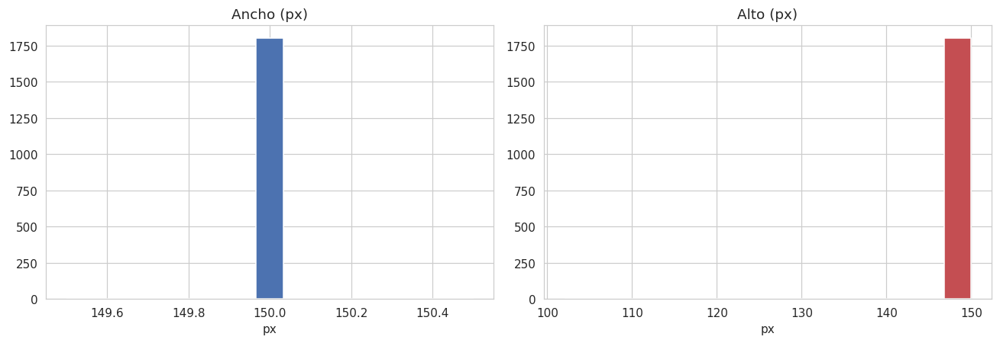

El ancho es constante (**150 px**) mientras que el alto varía (**~102–150 px**). Por lo tanto,
**redimensionar es obligatorio** para alimentar la red con tensores de tamaño fijo.

## 7. Metodología (CRISP-DM)

El proyecto sigue el ciclo **CRISP-DM**:

1. **Comprensión del negocio:** etiquetado automático de imágenes por tipo de escenario (sección 2).
2. **Comprensión de los datos:** EDA de balance, ejemplos y tamaños (sección 6).
3. **Preparación de los datos:** redimensionado a 128×128, normalización a `[0, 1]`, formato
   matricial `(H, W, C)`, partición 80/20 estratificada y aumento de datos (sección 8.1).
4. **Modelado:** diseño y entrenamiento de la CNN y del MLP de comparación (secciones 8 y 9).
5. **Evaluación:** métricas, matriz de confusión, ROC/AUC y comparación de modelos (secciones 10 y 11).
6. **Despliegue / comunicación:** informe, cuaderno reproducible y figuras (este documento).

## 8. Preparación de los datos y diseño de la CNN

### 8.1 Preparación de datos

| Paso | Decisión |
|---|---|
| Muestreo | 1.300 imágenes por clase (semilla `SEED=42`) para acotar el costo de cómputo |
| Redimensionado | 128×128 px (conserva detalle espacial; la EP1 usó 64×64 porque el MLP aplana) |
| Normalización | Píxeles de `[0, 255]` a `[0, 1]` (estabiliza y acelera el entrenamiento) |
| Formato | Tensor `(128, 128, 3)`, **sin aplanar** (requisito de las capas convolucionales) |
| Partición | 80/20 estratificada (train/validación) + `seg_test` independiente |
| Aumento de datos | Flip horizontal, rotación (8 %), zoom (10 %) y contraste (10 %), solo en entrenamiento |

### 8.2 Arquitectura

| Bloque | Capa | Configuración | Justificación |
|---|---|---|---|
| Entrada | `Input` | 128×128×3 | Formato matricial de la imagen |
| Aumento | Flip / Rotation / Zoom / Contrast | — | Regularización: más variedad sin más datos |
| Conv 1 | `Conv2D(32, 3×3)` + BN + ReLU ×2 | *same* | Bordes y texturas simples |
| Pool 1 | `MaxPooling2D` | 2×2 | Reduce resolución e introduce invariancia a traslaciones |
| Conv 2 | `Conv2D(64, 3×3)` + BN + ReLU ×2 | *same* | Combina texturas en patrones |
| Pool 2 | `MaxPooling2D` | 2×2 | Segunda reducción espacial |
| Conv 3 | `Conv2D(128, 3×3)` + BN + ReLU | *same* | Características de alto nivel |
| Pool 3 | `MaxPooling2D` | 2×2 | Última reducción espacial |
| Agregado | `GlobalAveragePooling2D` | — | Resume cada mapa en un valor (pocos parámetros) |
| Densa | `Dense(256, ReLU)` + `Dropout(0.5)` | — | Combina características; evita sobreajuste |
| Salida | `Dense(6, Softmax)` | — | Probabilidad por clase |

**Decisiones clave:** 5 convoluciones 3×3 agrupadas en 3 bloques (equilibrio capacidad/costo);
ReLU por su convergencia; MaxPool para reducir dimensión; BatchNorm para estabilidad y mejor
generalización; GlobalAveragePooling para reducir parámetros frente a aplanar; pérdida
`sparse_categorical_crossentropy`; optimizador **Adam** (`lr=1e-3`) con reducción automática del
*learning rate*; hasta 40 épocas con **Early Stopping** (paciencia 8) y `batch_size=32`.

## 9. Entrenamiento y evaluación

El entrenamiento registra pérdida y exactitud de entrenamiento y validación por época. Sobre el
**set de prueba independiente** se reportan *accuracy*, *precision*, *recall* y *F1* (ponderados y
por clase), matriz de confusión y curvas ROC/AUC.

> **Entorno de ejecución:** Google Colab con GPU NVIDIA Tesla T4 (el cuaderno detecta la GPU
> automáticamente). Ejecución completa sin errores.

### 9.1 Resultado global

| Modelo | Accuracy | F1 (weighted) | Parámetros | Tiempo (min) | Épocas |
|---|---|---|---|---|---|
| MLP (comparación) | 0.3807 | 0.2809 | 12.616.838 | 3.3 | 37 |
| **CNN (propuesta)** | **0.8270** | **0.8247** | **174.950** | 9.7 | 32 |

La CNN alcanza **82,7 % de accuracy** en el set de prueba: **+44,6 puntos** sobre el MLP
reentrenado bajo condiciones idénticas (38,1 %) y **+35,0 puntos** sobre el 47,7 % reportado por el
MLP en la EP1. Además lo logra con **~72 veces menos parámetros** (175 mil vs. 12,6 millones),
confirmando la eficiencia de la compartición de pesos frente al aplanado del MLP.

### 9.2 Curvas de aprendizaje (CNN)

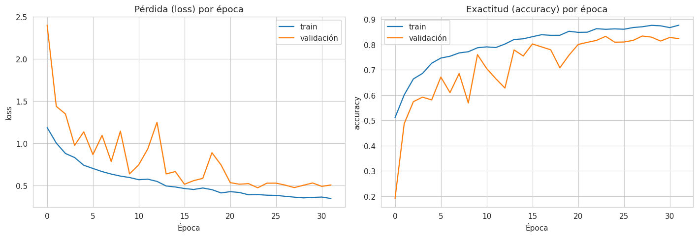

La exactitud de validación crece de forma sostenida y la pérdida de validación se mantiene cercana
a la de entrenamiento (**brecha train–val ≈ 0,05**), señal de que el modelo **generaliza** y no
memoriza. El *Early Stopping* detuvo el entrenamiento en la **época 32** (de 40 máximas).

### 9.3 Métricas por clase (CNN, set de test)

| Clase | Precision | Recall | F1 | Soporte |
|---|---|---|---|---|
| buildings | 0.85 | 0.83 | 0.84 | 437 |
| forest | 0.93 | **0.98** | 0.95 | 474 |
| glacier | 0.80 | 0.77 | 0.79 | 553 |
| mountain | 0.83 | **0.64** | 0.72 | 525 |
| sea | 0.73 | 0.89 | 0.80 | 510 |
| street | 0.85 | 0.87 | 0.86 | 501 |
| **Macro avg** | 0.83 | 0.83 | 0.83 | 3000 |

La clase más difícil es **`mountain`** (recall 0,64), que se confunde con `sea` y `glacier` por el
parecido de color (roca/nieve), confirmando la hipótesis del EDA.

### 9.4 Matriz de confusión y ROC/AUC

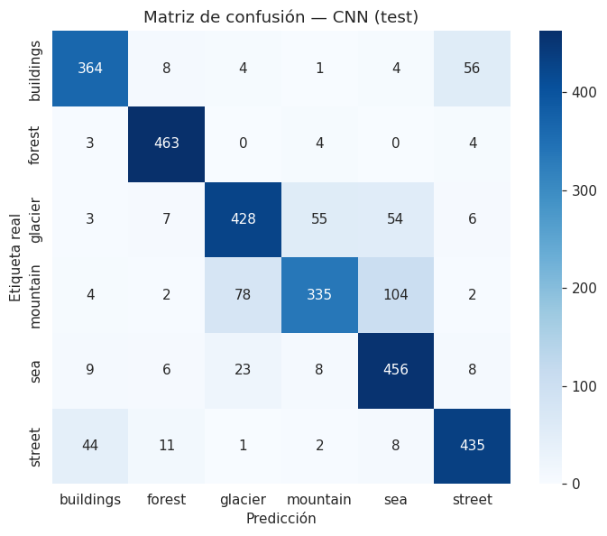

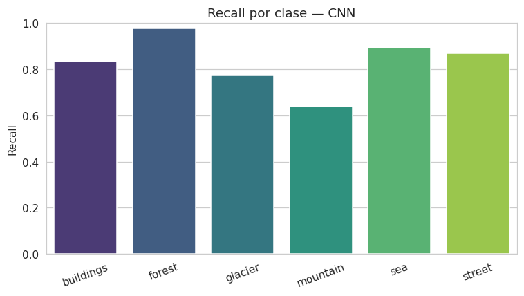

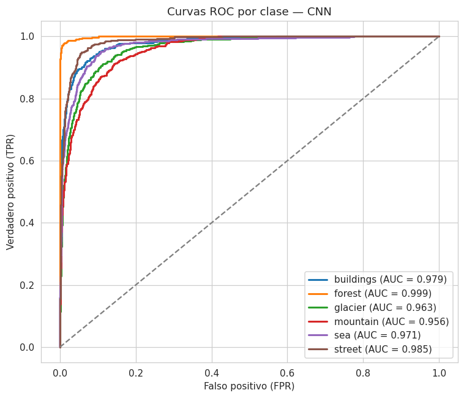

La matriz de confusión y las curvas ROC (AUC mostrado por clase en la leyenda) confirman el
patrón: `forest` (recall 0,98) y `sea` (0,89) se detectan bien, mientras que **`mountain`
concentra los errores** (104 veces clasificada como `sea` y 78 como `glacier`).

## 10. Comparación MLP vs. CNN

Para comparar **justamente**, ambos modelos se entrenan con la **misma partición, resolución y
aumento de datos**. La única diferencia es la arquitectura: el MLP aplana la imagen; la CNN aplica
convoluciones.

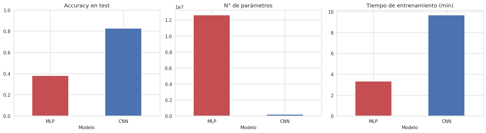

**Análisis.**

- **Desempeño:** la CNN **82,7 %** vs. el MLP **38,1 %** (mismas condiciones). La CNN aprovecha la
  estructura espacial; el MLP pierde la relación entre píxeles vecinos (el mismo fenómeno que lo
  limitó al 47,7 % en la EP1).
- **Parámetros:** el MLP tiene **12,6 millones** de parámetros (su primera capa densa domina) y aun
  así rinde peor: son parámetros poco eficientes. La CNN logra más con **175 mil** parámetros
  (**~72× menos**) gracias a la **compartición de pesos** de los filtros.
- **Tiempo:** la CNN es más costosa por época (32 épocas en 9,7 min) que el MLP (37 épocas en
  3,3 min), pero entrega una exactitud más de **dos veces mayor**.
- **Generalización:** la brecha train–validación de la CNN (+0,053) y del MLP (−0,056) es pequeña en
  ambos; la diferencia de desempeño se explica por la **arquitectura**, no por sobreajuste.

## 11. Mapas de características y activaciones

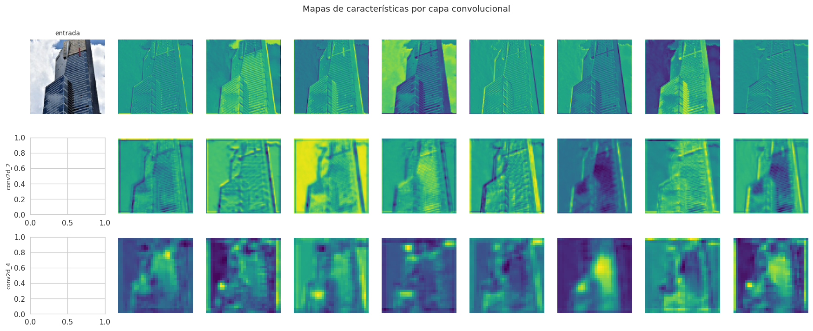

En las **primeras capas** los mapas son casi versiones filtradas de la imagen (bordes y contraste);
en las **capas profundas** son más pequeños y abstractos: representan **patrones de escena** y no
píxeles. El promedio de activaciones por clase (**`images/activacion_por_clase.png`**) muestra qué
regiones tiende a "encender" la red para cada categoría; cuando dos clases activan regiones
parecidas, aparecen las confusiones observadas.

## 12. Análisis de resultados y de errores

Se revisan ejemplos correctamente e incorrectamente clasificados y se identifican las clases con
mayor dificultad.

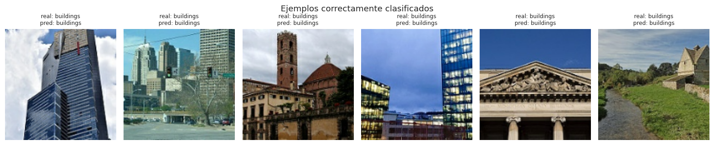

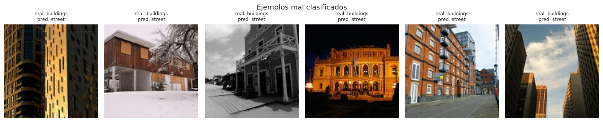

Las confusiones se concentran en clases **visualmente parecidas** (`glacier` ↔ `mountain`, ambas con
nieve/roca; y `sea` ↔ `street` en algunos encuadres). La causa es doble: similitud real de color y
textura, y escenas ambiguas incluso para una persona. Aun así, la CNN comete **muchos menos errores**
que el MLP porque usa la **forma y disposición** de los elementos, no solo el color promedio.

## 13. Conclusiones y trabajo futuro

1. **CNN vs. MLP:** la CNN obtiene **82,7 %** de exactitud, frente al **47,7 %** del MLP de la EP1
   (y al 38,1 % del MLP reentrenado con la variante de esta entrega), confirmando que **la
   estructura espacial importa**.
2. **Ventajas de la CNN:** detección automática de características, invariancia a traslaciones y
   menor número de parámetros efectivos.
3. **Limitaciones:** las clases de apariencia similar siguen confundiéndose; el dataset carece de
   contexto y la muestra de entrenamiento es acotada.
4. **Mejoras futuras:** *data augmentation* más agresivo, `Dropout` espacial, regularización L2,
   **Transfer Learning** (MobileNet/ResNet preentrenados) y *fine-tuning*.

## 14. Declaración de uso de Inteligencia Artificial

Se utilizó Inteligencia Artificial como **apoyo** para la redacción y organización del cuaderno y
del informe. Todas las decisiones técnicas —variante, arquitectura, hiperparámetros, regularización
y análisis— fueron definidas y validadas por el equipo, que ejecutó y verificó cada celda.
Referencia de citación: <https://bibliotecas.duoc.cl/ia>

## 15. Referencias

- Intel Image Classification (Kaggle): <https://www.kaggle.com/datasets/puneet6060/intel-image-classification>
- Keras — Guías de CNN: <https://keras.io/guides/>
- CRISP-DM: <https://www.ibm.com/docs/en/spss-modeler/latest?topic=dm-crisp-help-overview>
